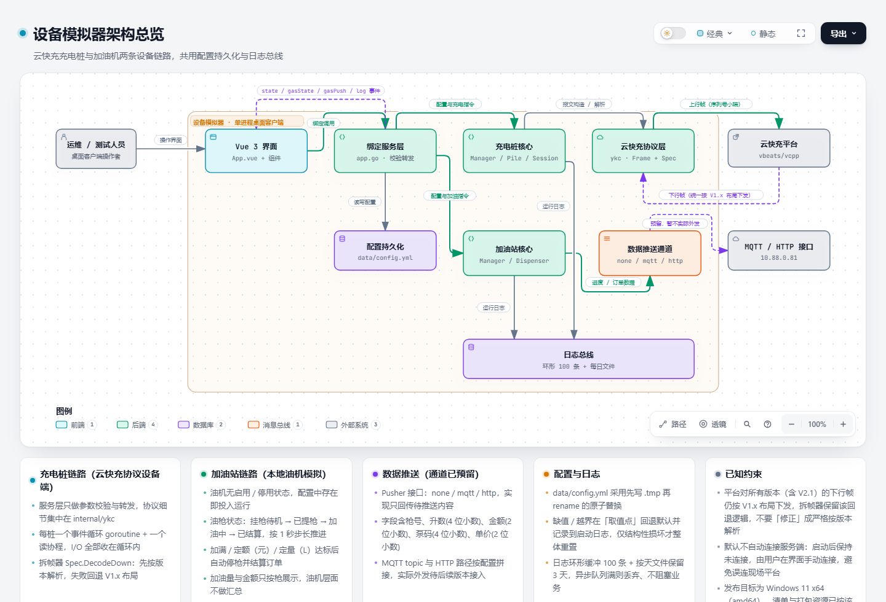

# 设备模拟器（vcpp-emulator）

设备模拟器桌面客户端，内置两套并行的设备模拟：

- **充电桩（云快充协议）**：单应用可同时模拟多台充电桩（每桩可配置多枪），
  自动完成登录、心跳、计费模型、启停充电、实时数据、交易记录全流程，并实时展示通信日志。
  它模拟协议的**设备端**；对端平台服务端实现见：<https://github.com/vbeats/vcpp>
- **加油站（加油机）**：模拟加油机油枪的提枪 / 加油 / 挂枪结算流程，支持自动生成油机与油枪、
  按油号区分油品与颜色、统一油价、定额 / 定量自动停枪，并将加油进度与加油订单数据
  以 MQTT 或 HTTP POST JSON 形式对外推送（推送通道已预留，当前版本暂不实际外发）。

开发约定（AI 编码助手必读）见 [AGENTS.md](AGENTS.md)。

## 技术栈

| 层次 | 选型 |
| --- | --- |
| 桌面框架 | Wails **v3.0.0**（稳定版，非 nightly 快照） |
| 前端 | Vue 3 + TypeScript + Vite + Tailwind CSS v4 |
| 语言 | Go 1.26+ |
| 构建目标 | **Windows 11 x64（amd64）**（不考虑低版本 Windows） |

版本策略：wails 与其它依赖均锁定各软件**最新正式发布版**（不含 alpha / beta / nightly 等快照版本）。

## 目录结构

```
├── main.go                 # wails v3 应用入口（窗口、服务、事件注册）
├── app.go                  # 绑定到前端的服务层（配置 / 桩管理 / 充电控制 / 加油站 / 日志）
├── Taskfile.yml            # 构建、打包、开发任务
├── build/                  # 各平台构建配置与资源（build/config.yml 为产品元信息）
└── internal
    ├── ykc/                # 云快充协议：帧编解码、版本能力、各报文构造与解析
    ├── emu/                # 充电桩模拟器核心：多桩多枪状态机、电池模型、费率统计
    ├── gas/                # 加油站模拟器核心：多油机多枪状态机、加油推进与订单、数据推送
    ├── logger/             # 日志总线：环形 100 条 + 每日文件 + 3 天清理
    └── store/              # 配置持久化
```

## 架构



交互式版本（可缩放、点选节点查看说明）：[doc/vcpp-emulator-architecture.html](doc/vcpp-emulator-architecture.html)

两条设备链路在同一进程内并行，共用服务层、配置持久化与日志总线：

- **充电桩主链路**：
  `运维/测试人员 → Vue 3 界面 → App 服务层（Wails 绑定） → emu.Manager → emu.Pile → ykc 协议层 → 云快充平台（TCP 9847~9851）`
  - `emu.Pile → 充电会话`：电池 / 费率模型推进
  - `emu.Pile → 日志总线 → 前端 log 事件 + 日志文件`
  - `emu.Manager` 快照经 300ms 节流后由 `App 服务层` 以 `state` 事件推送前端
- **加油站主链路**：
  `Vue 3 界面 → App 服务层 → gas.Manager → gas.Dispenser → 数据推送通道（none / mqtt / http）`
  - `gas.Dispenser → 日志总线`：运行日志
  - 油机无启用 / 停用状态，配置中存在即投入运行；加油量与金额只按枪展示
  - 推送通道已预留（topic / 接口按配置拼接），实际外发待后续版本接入
- **公共设施**：`App 服务层 ↔ 配置持久化（data/config.yml 原子替换）`、`App 服务层 → 日志总线`
- 对端平台服务端实现：<https://github.com/vbeats/vcpp>

## 运行与构建

```bash
# 开发模式（热重载，不生成安装包）
wails3 dev

# 构建 Windows 11 x64（ARCH 默认 amd64，输出到 bin/）
wails3 build

# NSIS 安装包（会先执行构建）
task windows:package

# MSIX 包（需先安装工具：task install:msix:tools）
task windows:package FORMAT=msix

# macOS 交叉构建（保留能力，非发布目标）
wails3 build GOOS=darwin
```

> Wails CLI 位于 `C:\Users\bootv\go\bin\wails3.exe`，`task` 位于同目录；未加入 PATH 时需用完整路径调用。

> Windows 桌面发布目标固定为 **Windows 11 x64**：`build/windows/Taskfile.yml` 中 `ARCH` 默认为 `amd64`，
> 应用清单仅声明 Windows 11 兼容项，不做低版本 Windows 兼容。

前端单独调试：

```bash
cd frontend
npm install
npm run build      # vue-tsc 类型检查 + vite 打包
```

## 功能

- **模块并行**：左侧 tab 切换「充电桩」与「加油站」两套界面，互不干扰
- **服务端配置**：IP / 端口 / 协议版本联动（9847~9851 对应 V1.5~V2.1）
- **手动连接**：应用启动后保持未连接，需在界面手动连接；连接中断后按 `reconnect-sec`（默认 30 秒）自动重连
- **多桩多枪**：侧栏增删桩，每桩可指定枪数量（1~10）、直流/交流、额定功率、程序版本
- **全自动充电**：设置充电目标（金额 / 时长 / 电量 / SOC），达标后自动停止并上送交易记录
- **实时参数**：电压、电流、功率、SOC、已充电量、金额、时长、剩余时间、枪温/电池温、BMS 需求
- **通信日志**：界面滚动展示最近 100 条，支持关键字过滤、自动滚动、展开报文 HEX

### 加油站模块

- **数据推送配置（全站公共）**：推送形式（不推送 / MQTT / HTTP）与各油价均为油站公共资源，
  所有油机共用，入口在左侧「推送配置」，不按单台油机分别配置
- **油机批量生成**：在侧栏指定油机台数与每台枪数，一键生成；油机号 `01 / 02 ...`，
  每台油机的枪号固定从 `1` 开始递增（`1 ~ x`），编号字段均为字符串类型；
  台数与枪数仅在生成时使用，生成结果落在 `gas.dispensers`，不写入配置文件
- **油品区分**：每把枪可配置油号，目录含柴油 `-10# / 0#`、汽油 `92# / 95# / 98#`、甲醇 `100#`，
  不同油品在界面以不同颜色标识
- **统一油价**：按油号统一配置单价（元 / 升，两位小数）
- **自动加油**：支持加满 / 定额（元）/ 定量（L）三种目标，定额、定量达标后自动停枪并结算订单；
  加油量与金额只在每把枪的区块展示，油机层面不做汇总
- **油机状态**：油机没有启用 / 停用状态，配置中存在即随应用启动投入运行
- **数据推送**：加油过程进度与加油完成订单数据均支持推送，字段含枪号、升数（4 位小数）、
  金额（2 位小数）、泵码（4 位小数）、单价（2 位小数）等；推送通道（MQTT topic / HTTP 接口）
  已按配置预留，实际外发待后续版本接入

## 连接与退出

- 启动后不自动建立 TCP 连接，仅当配置文件显式设置 `auto-connect: true` 时才自动连接已启用的桩。
- 手动连接的桩在通信过程中断开会持续自动重连（默认间隔 30 秒，可在配置文件调整 `reconnect-sec`）。
- 退出应用时由 wails 生命周期回调逐个销毁已建立的 TCP 连接后再关闭日志文件。

## 日志

- 界面仅保留最近 100 条，支持关键字过滤与自动滚动开关。
- 文件位于应用安装目录下的 `logs/emu-YYYY-MM-DD.log`，每天一个文件，仅保留最近 3 天。

## 配置文件

配置解析方式对齐服务端 <https://github.com/vbeats/vcpp>（Spring Boot 的 `application.yml` + `@ConfigurationProperties`）：

- **文件**：单个 YAML 文件，默认 `<可执行文件同目录>/data/config.yml`，首次运行自动按默认模板生成，可直接手工编辑。
- **发现顺序**：环境变量 `VCPP_EMU_CONFIG`（显式指定路径）→ `data/config.yml` → 旧版 `data/config.json`（读取后自动迁移为 YAML，原文件保留为 `.bak`）。
- **默认值与容错**：缺省字段、空值、超出合理区间的取值（如 `heartbeat-sec` 需在 5~600 之间）会在「取值点」回退默认值，
  并在启动日志输出修正说明，**不因此拒绝启动**——与服务端一致的降级策略。
- **持久化**：界面保存服务端配置 / 桩配置 / 加油站配置、每次「启动充电」与「开始加油」的填写内容都会写回该文件
  （先写 `.tmp` 再 `rename` 原子替换），重启后原样恢复。

```yaml
server:
    host: 10.88.0.81
    port: 9847
    version: V15            # V15 / V16 / V17 / V18 / V21
piles:
    - id: pile-1
      pile-no: "20260501000001"
      gun-count: 2
      pile-type: 0          # 0 直流 1 交流
      rated-power: 120
      program-ver: "220422"
      enabled: false
heartbeat-sec: 10           # 心跳周期 [5,600]
real-time-idle-sec: 300     # 空闲实时数据周期 [10,3600]
real-time-charge-sec: 15    # 充电中实时数据周期 [5,600]
auto-reconnect: true
reconnect-sec: 5            # 重连间隔 [1,600]
last-start-charge:          # 最近一次「启动充电」表单填写内容（仅保留最近一份）
    start-type: 1           # 1 刷卡 3 VIN
    card-no: "88888888"
    battery-kwh: 60
    start-soc: 20
    max-voltage: 750
    max-current: 250
    target:
        mode: amount        # amount / time / energy / soc
        amount: 30
        minute: 30
        energy: 20
        soc: 90
gas:                        # 加油站（全站公共配置，所有油机共用）
    push-mode: mqtt         # none / mqtt / http
    mqtt:                   # MQTT 推送（18083 为 EMQX 控制台端口，连接默认 1883）
        broker: 10.88.0.81
        port: 1883
        client-id: vcpp-emulator-gas
        username: admin
        password: admin123456
        topic-progress: vcpp/gas/{dispenser}/nozzle/{nozzle}/progress
        topic-order: vcpp/gas/{dispenser}/nozzle/{nozzle}/order
        qos: 1
    http:                   # HTTP POST JSON 推送
        base-url: http://10.88.0.81:18083
        path-progress: /api/gas/fuel/progress
        path-order: /api/gas/fuel/order
        token: ""
        timeout-sec: 10
    prices:                 # 统一油价（元 / 升，两位小数）
        - code: "92#"
          price: 7.68
        - code: "95#"
          price: 8.19
    dispensers:             # 油机列表（无启用 / 停用状态，存在即运行）
        - id: dispenser-1
          dispenser-no: "01"
          nozzle-count: 2
          nozzles:
            - no: "1"
              fuel-code: "92#"
            - no: "2"
              fuel-code: "95#"
    push-interval-sec: 5    # 加油过程推送周期 [1,600]
    tank-volume-l: 60       # 油箱容积 [1,500]，加满自动跳枪
    last-start-fuel:        # 最近一次「开始加油」表单填写内容（仅保留最近一份）
        target:
            mode: amount    # free / amount / volume
            amount: 200
            volume: 30
        card-no: "88888888"
        plate-no: "京A12345"
```

## 验证

单元测试（离线）：

```bash
# 充电桩：帧编解码 / CRC / BCD / CP56Time2a，含真实桩报文样本
go test ./internal/ykc/ -v

# 加油站：定额 / 定量 / 加满自动停枪、订单结算、油机油枪编号、推送通道
go test ./internal/gas/ -v

# 全部
go test ./internal/... .
```

联网冒烟（对真实服务端验证登录 / 心跳 / 计费模型 / 启停 / 实时数据 / 交易记录）：

```bash
# 握手冒烟，可切换 9847~9851 分别验证 V1.5~V2.1
VCPP_SMOKE_HOST=10.88.0.81 VCPP_SMOKE_PORT=9847 go test ./internal/emu -run TestSmokeServer -v

# 完整充电流程：启动 → 实时数据 → 达标停止 → 交易记录确认
VCPP_SMOKE_HOST=10.88.0.81 VCPP_SMOKE_PORT=9847 go test ./internal/emu -run TestFullChargeFlow -v -timeout 120s
```
